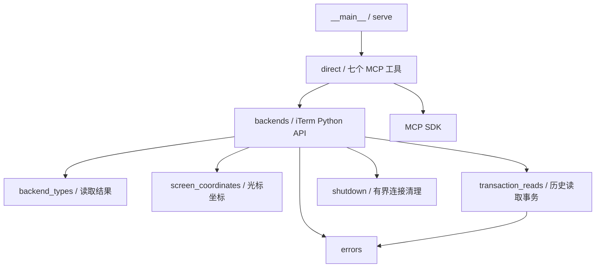

# iTerm API MCP 依赖梳理与清理记录

范围：保留现有 `serve` 入口的七个 MCP 工具；不保留未来可能使用的 CLI、管理端或仲裁实现。

## 清理前的真实依赖

完整的模块导入图、源文件行数、测试/脚本导入、第三方包声明见 `cleanup-dependencies.json`。

- `__main__` 在模块加载阶段导入 broker、gateway、admin、core、ledger、actor slots、凭据及恢复系统，即便运行 `serve` 也会加载这些模块。
- `direct` 使用 `ItermBackend` 的连接、枚举、屏幕/历史读取和发送，并增加窗口/标签页创建。
- `backends` 同时包含真实 iTerm、模拟 CLI、前台 PID/TTY 采样。只有基础 iTerm 操作属于当前目标。
- `capture` 目前创建 `terminal_cells`，但 `direct` 不返回也不使用这个字段。逐 cell UTF-16 展开、样式与 CLI 输入等价性推断可删除；保留直接读取 raw response 的完整行文本，避免 SDK 逐 cell 字符切片问题。
- 屏幕光标是绝对缓冲区坐标，仍需要基于返回范围转换；不能随着 cell 解析一起删掉。
- 历史读取使用 iTerm 事务，取消/超时后的事务结束和连接清理仍需要 `transaction_reads`、`shutdown`。
- 测试中存在混合模块：`test_backends` 含旧适配器/模拟 CLI 测试，`test_iterm_history` 含观察引擎测试，`test_bounded_transport_close` 含 broker/admin 测试。只提取当前后端和清理路径用例。

## 保留的依赖方向

## 删除范围

| 类别 | 删除项 | 原因 |
|---|---|---|
| 旧控制系统 | broker、gateway、core、policy、arbitration、ledger、observation、scheduling | 当前入口直接封装 API，不使用共享控制平面 |
| 管理和身份系统 | admin、managed runtime、actor slots/recovery、credential、keyring、transport、reviewed/context source 系列 | 仅服务旧 broker/admin |
| CLI 认证 | adapters/registry/selection、Claude/Codex screen、foreground/context sampling、terminal cell 解析 | 不属于终端 API 封装 |
| 模拟实现 | FixtureBackend、FakeBackend、CLI 语义状态 | 以测试中的轻量 SDK 替身验证当前 API 即可 |
| schema | 原15工具及管理协议 schemas、同步脚本 | 当前七工具由 FastMCP 参数生成 schema |
| 界面和实验 | electron、experiments、管理应用构建目录、临时 Codex Rust 源码/构建缓存 | 当前目标不使用 |
| 文档与脚本 | 旧设计、认证、恢复、CLI 探针和 elicitation 测试 | 删除过时使用路径，仅保留当前说明和本次依赖清单 |
| 测试 | 被删除功能的测试；混合文件中相关用例 | 不让旧系统通过测试反向成为生产依赖 |

## 第三方依赖

运行直接依赖为 `mcp==1.30.0`、`iterm2==2.30`。iTerm 从可选依赖改为必需依赖；删除项目直接使用的 jsonschema 声明，但 MCP SDK 本身依赖 jsonschema，所以锁文件中的 jsonschema 及其传递依赖必须保留。不升级任何包。

## 验证门槛

1. 保留模块和测试没有指向已删除模块的导入；入口仅有 serve。
2. 运行受影响的 MCP、iTerm 后端、历史事务、坐标及清理定向测试。
3. 构建 wheel，检查 wheel 不再包含旧模块或 schemas。
4. 通过真实 stdio MCP 创建专用 `/bin/cat` 会话，验证发送/读取并清理。
5. 保留用户环境 `.venv`、`.codex`、本地配置备份和旧会话恢复记录；仅移除此前添加的 `cc_iterm_smoke` 测试服务配置及匹配进程。

## 执行结果（2026-10-17）

- 原 45 个 Python 模块：删除 37 个旧文件（包括由小型坐标模块替代的 wire_cells），保留/精简 8 个，新增 screen_coordinates，最终共 9 个。
- 删除旧控制/管理/认证/恢复系统、模拟 CLI、逐 cell 样式/输入解析、schemas、Electron、CLI 实验、旧脚本及过时设计文档。没有保留一套备用旧实现。
- 旧测试文件删除或拆分，最终保留 8 个测试模块、59 项定向测试。捕获字节上限新增 JSON 转义及 Unicode 边界回归测试；并非把旧功能测试改成跳过。
- 删除约 20 GB 的任务专用 Rust 构建目录、126 MB 的源码副本，以及 Electron 依赖和管理应用构建产物。
- 原运行环境中的 `cc_iterm_smoke` 用户级 MCP 配置已移除，三个匹配的旧测试服务进程已停止。官方 CLI 在删除时归一化了其他服务的默认字段；已恢复它们的显式写法，并与此前配置备份逐项比较，除删除测试服务外一致。命令语义参考 [官方命令说明](https://learn.chatgpt.com/docs/developer-commands?surface=cli)。
- 本地配置备份和旧测试会话的证据/恢复记录保留在忽略的 `.local`；它们不随包发行。没有向旧会话发送清除或退出按键。
- 59 项定向测试、Ruff、pip check、入口 help、静态导入闭包检查通过。wheel 中只有当前9模块，没有旧 schemas/模块；直接从 wheel 加载可发现7个 MCP 工具。
- 真实 stdio MCP → iTerm 验证通过：新建窗口、标签页、文本、Enter、中文/emoji 屏幕匹配、非空历史匹配。两测试会话均已关闭。
- 未运行旧全量测试、未使用 Python reload、未提交或推送 Git、未升级依赖。
