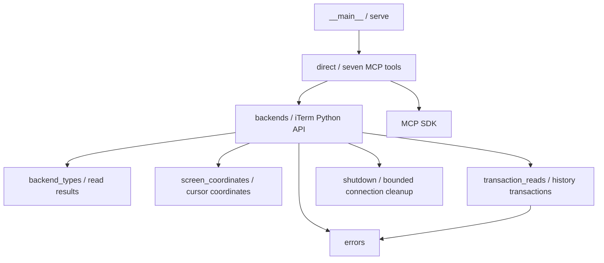

# iTerm API MCP dependency audit and cleanup record

Scope: retain the seven MCP tools exposed by `serve`. Do not retain CLI, administration, or arbitration implementations for hypothetical future use.

## Dependencies before cleanup

The complete module import graph, source line counts, test/script imports, and third-party dependency declarations are recorded in [cleanup-dependencies.json](cleanup-dependencies.json).

- `__main__` imported the broker, gateway, admin, core, ledger, actor slots, credentials, and recovery systems at module load time, even when running `serve`.
- `direct` used `ItermBackend` for connections, session listing, screen/history reads, and sends, and added window/tab creation.
- `backends` combined real iTerm operations, simulated CLIs, and foreground PID/TTY sampling. Only the basic iTerm operations belong to the current scope.
- `capture` generated `terminal_cells`, which `direct` neither returned nor used. Per-cell UTF-16 expansion, styling, and CLI input-equivalence inference could be removed. Reading complete line text from raw responses was retained to avoid SDK per-cell character slicing issues.
- Screen cursors use absolute buffer coordinates and still require conversion based on the returned range. This conversion must survive removal of cell parsing.
- History reads use iTerm transactions. Ending transactions and cleaning up connections after cancellation or timeout still require `transaction_reads` and `shutdown`.
- Some test modules mixed responsibilities: `test_backends` included legacy adapter/simulated CLI tests, `test_iterm_history` included observation-engine tests, and `test_bounded_transport_close` included broker/admin tests. Only cases covering the retained backend and cleanup paths were preserved.

## Retained dependency graph

## Removal scope

| Category | Removed components | Rationale |
| --- | --- | --- |
| Legacy control system | broker, gateway, core, policy, arbitration, ledger, observation, scheduling | The current entry point directly wraps the API without a shared control plane. |
| Administration and identity | admin, managed runtime, actor slots/recovery, credentials, keyring, transport, reviewed/context source components | Used only by the legacy broker/admin system. |
| CLI certification | adapters/registry/selection, Claude/Codex screen handling, foreground/context sampling, terminal cell parsing | Outside the terminal API wrapper's scope. |
| Simulations | FixtureBackend, FakeBackend, CLI semantic states | Lightweight SDK test doubles suffice for the current API. |
| Schemas | Legacy 15-tool and management protocol schemas, synchronization scripts | FastMCP generates schemas from the seven current tools' parameters. |
| UI and experiments | Electron, experiments, management app build directories, temporary Codex Rust source/build caches | Not used by the current implementation. |
| Documentation and scripts | Legacy design, certification, recovery, CLI probes, elicitation tests | Remove obsolete usage paths; retain current documentation and the dependency audit. |
| Tests | Tests for removed features and corresponding cases in mixed modules | Prevent tests from turning the old system into a production dependency. |

## Third-party dependencies

Direct runtime dependencies are `mcp==1.30.0` and `iterm2==2.30`. iTerm became a required dependency rather than an optional one. The project's direct jsonschema declaration was removed, but the MCP SDK depends on jsonschema, so it and its transitive dependencies remain in the lockfile. No packages were upgraded.

## Verification criteria

1. Retained modules and tests must not import removed modules; `serve` is the only entry-point subcommand.
2. Run the affected MCP, iTerm backend, history transaction, coordinate, and cleanup tests.
3. Build a wheel and confirm that it contains no legacy modules or schemas.
4. Use a real stdio MCP connection to create dedicated `/bin/cat` sessions, verify sends/reads, and clean up.
5. Preserve `.venv`, `.codex`, local configuration backups, and old session recovery records. Remove only the previously added `cc_iterm_smoke` test server configuration and matching processes.

## Results recorded on October 17, 2026

These results describe the cleanup milestone. Later connection fixes and tests are documented in [test-results.md](test-results.md).

- Of the original 45 Python modules, 37 old files were removed, including `wire_cells`, which was replaced by a small coordinate module. Eight modules were retained or reduced, and `screen_coordinates` was added, leaving nine runtime modules.
- Removed the legacy control, administration, certification, and recovery systems; simulated CLIs; per-cell styling/input parsing; schemas; Electron; CLI experiments; old scripts; and obsolete design documents. No standby legacy implementation was retained.
- Old test files were removed or split, leaving eight test modules and 59 focused tests at this milestone. Capture-size limits gained JSON escaping and Unicode boundary regressions; legacy feature tests were not merely skipped.
- Removed approximately 20 GB of task-specific Rust build files, a 126 MB source copy, Electron dependencies, and management app build artifacts.
- Removed the user-level `cc_iterm_smoke` MCP configuration and stopped three matching old test-server processes. The official CLI normalized other servers' default fields during removal; their explicit values were restored and compared against the prior backup. Only the test server configuration differed afterward. See the [official command documentation](https://learn.chatgpt.com/docs/developer-commands?surface=cli).
- Local configuration backups and old session evidence/recovery records remain in the ignored `.local` directory and are not distributed with the package. No clear or exit keys were sent to old sessions.
- All 59 focused tests, Ruff, pip check, entry-point help, and static import-closure checks passed. The wheel contained only the nine runtime modules, with no legacy modules or schemas. Loading directly from the wheel exposed seven MCP tools.
- Live stdio MCP → iTerm verification passed: window and tab creation, text and Enter input, Chinese/emoji screen matching, and nonempty scrollback matching. Both test sessions were closed.
- During this cleanup milestone, the legacy full test suite was not run, Python reload was not used, no Git commit or push was performed, and no dependencies were upgraded.
